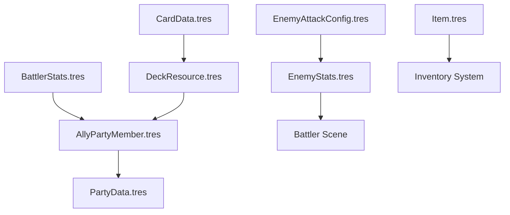

# Technical Architecture & Systems

This document details the technical implementation and modular architecture of the 3D turn-based combat system in Godot 4.x.

## 1. Core Singletons (Autoloads)

These systems persist across scenes and manage the global state of the game and combat engine.

- **`GlobalBattleSettings`**: Central hub for combat enums (Teams, Elements, Target Types), global damage multipliers, and shared audio stream references.
- **`GameState`**: Manages the persistent run data, including current party members, inventory, and progression flags.
- **`SignalBus`**: Facilitates decoupled communication between UI components, the camera system, and the BattleManager.
- **`PartyBattleSync`**: Orchestrates the transfer of stats (HP, XP, Decks) between the persistent `AllyPartyMember` resources and the active `Battler` nodes in a scene.
- **`DifficultyManager`**: Applies global scaling factors to damage, defense, and rewards based on the selected difficulty level.
- **`SaveLoader`**: Handles the serialisation and de-serialisation of the run state to disk.

## 2. Key Combat Classes

### 2.1 BattleManager (`battle_manager.gd`)
The central orchestrator of the battle loop. It manages:
- Spawning allies and enemies via `Troops` resources.
- Turn order calculations based on Agility stats.
- Transitioning between UI states (Player Turn, Enemy Turn, Execution).
- Checking win/loss conditions.

### 2.2 Battler (`battler.gd`)
The base unit for all combatants (NPCs and Players). Inherits from `Node3D` and contains:
- **`active_states`**: A dictionary tracking current `State` resources (Buffs/Debuffs).
- **`stats`**: A reference to the underlying `BattlerStats` or `EnemyStats` resource.
- **`AnimationTree`**: Logic for managing movement, attacks, and hit reactions.

### 2.3 RealTimeDefenseManager
Specifically handles the timing-based input windows for Parry, Dodge, and Jump during the `ENEMY_TURN` state. It communicates with the `AttackIndicator3D` to provide visual feedback.

### 2.4 Formulas
A static utility class containing the mathematical logic for damage calculation, status effect procs, and the exponential experience curve.

## 3. Resource Data Pipeline

The project uses a data-driven approach where gameplay logic is decoupled from data.

## 4. Visual & Camera Systems

### 4.1 Shader Overlay Stack
Battlers support a priority-based overlay chain for stacking visual effects. The `next_pass` chain is dynamically rebuilt whenever a status (like Burning or Electrocuted) is added or removed, ensuring high-priority highlights (like selection) always render on top.

### 4.2 State-Driven Battle Camera
The camera is a dynamic node that transitions between specific focus modes:
- **Overview**: Wide shot of the field.
- **Focus**: Close-up on the acting battler or target.
- **Over-the-Shoulder**: Positioned behind the defender to facilitate the Real-Time Defense system.

## 5. Battle Scene Structure

Standard node structure for a combat encounter:

- **BattleManager (Node3D)**
  - **BattleHUD (CanvasLayer)**: Contains Party Panels, Turn Queue, and Card UI.
  - **BattleCameraController**: Manages cinematic pivots.
  - **RealTimeDefenseManager**: Logic for parry/dodge windows.
  - **AllyContainer/EnemyContainer**: Parents for spawned battler nodes.
  - **SpawnPoints**: Marker3D nodes for formation positioning.